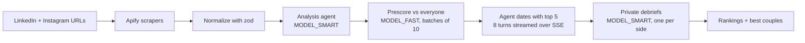

# agentdate

Paste someone's LinkedIn and Instagram. An analysis agent builds a dating profile from those two sources alone, with every trait backed by a quote. Then that person's agent goes on short dates with other people's agents, each agent privately debriefs, and everyone gets ranked.

Built with Next.js 15 (App Router), Drizzle + Neon Postgres, Apify, and OpenAI.

## How it works



| Step | Code |
| --- | --- |
| Scrape and normalize | `lib/scrape.ts` (actor inputs in `ACTOR_INPUTS`) |
| Profile analysis | `lib/analyze.ts` |
| Prescoring | `lib/prescore.ts` |
| Dates and debriefs | `lib/dating.ts`, streamed by `POST /api/dates` |
| Rankings | `lib/rank.ts` |
| All OpenAI calls | `lib/llm.ts` (the only file that imports the SDK) |

## The two-source rule

A profile is built **only** from that person's normalized LinkedIn and Instagram data. Nothing else goes in: no outside knowledge, even about famous people.

- Every trait, lifestyle item and dealbreaker quotes its evidence. `groundAnalysis` checks that each quote really appears in the source text and **drops anything it can't find**.
- What the two sources don't reveal is listed under **gaps** instead of guessed.
- Protected attributes (religion, ethnicity, caste, orientation, gender identity, health, politics) are never inferred.
- On dates, each agent sees only its own person's profile and may not invent people, places or anecdotes. It learns about the other person through the conversation.
- Private Instagram accounts and empty scrapes fail with a clear error; nothing is fabricated to fill the hole.

## Scoring

```
prescore  = 0-100 from the fast model, comparing two profiles
mutual    = harmonic mean of both agents' debrief scores = 2ab / (a + b)
final     = 0.25 * prescore + 0.75 * mutual
```

The harmonic mean punishes one-sided interest: 90 and 30 gives 45, while 60 and 60 gives 60. Candidates who have been on a date rank above those who haven't; undated candidates are ordered by prescore alone and flagged "not dated yet", because a real two-sided verdict is worth more than an untested estimate. **Best couples** are pairs where both agents want a second date, ordered by `mutual`.

## Local setup

Requires Node 20+, a [Neon](https://neon.tech) database, an [Apify](https://apify.com) token and an OpenAI key.

```bash
npm install
cp .env.example .env        # fill in DATABASE_URL, APIFY_TOKEN, OPENAI_API_KEY
npm run db:push             # create the tables
npm run dev                 # http://localhost:3000
```

Pages: `/` add a person, `/people`, `/p/[id]` profile, `/dates`, `/dates/[id]` transcript, `/rankings`, `/demo`.

## Seeding the demo

```bash
npm run db:seed                 # people -> profiles -> prescores -> dates
npm run db:seed -- --plan       # show which dates would run, without running them
npm run db:seed -- --no-dates   # stop after prescores
```

The seed reads `data/people.csv` (`name,linkedin_url,instagram_url`). For each person it:

1. skips them if they're already `ready`,
2. otherwise ingests and analyzes them, 4 at a time. If already-scraped Apify output is in `fixtures/ig-batch.json` and `fixtures/li-batch.json`, it uses that; otherwise it scrapes live,
3. prescores everyone against everyone,
4. runs dates between each person and their top 5, with A–B and B–A run only once, 4 at a time.

It is **resumable**: re-run it and it only does what's missing. Failures are logged, the run continues, and a summary is printed at the end. `/demo` then shows everything with no input needed.

Other scripts:

| Command | What it does |
| --- | --- |
| `npm run analyze` | Analyze everyone stuck in `analyzing` (`--failed` to retry failures) |
| `npm run test:scrape -- <ig-url> <li-url>` | Scrape and print normalized output (`--fixtures` for a free offline run) |
| `npm run db:studio` | Browse the database |
